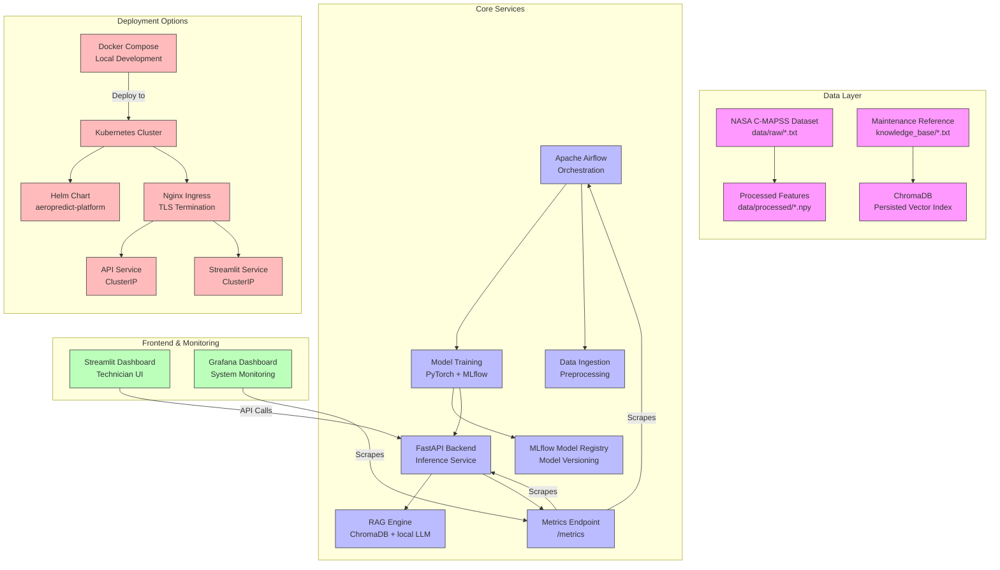

# AeroPredict: GenAI-Powered Predictive Maintenance Platform


**AeroPredict** is a production-grade MLOps platform designed to predict the Remaining Useful Life (RUL) of aircraft turbofan engines. It integrates a PyTorch LSTM network for time-series forecasting with a GenAI diagnostics module (a local LLM via Ollama, model configurable) that generates maintenance recommendations.

The system is built on the NASA C-MAPSS dataset and orchestrates the entire lifecycle—from data ingestion to technician reporting—using Apache Airflow, MLflow, and Docker.

## Key Features

- **Deep Learning Forecasting:** A custom LSTM (Long Short-Term Memory) network trained on multivariate C-MAPSS sensor trajectories to predict RUL using an asymmetric safety-first loss (MSE with a higher penalty for late/under-estimated predictions), with fallback baseline when model is unavailable.
- **GenAI Diagnostics (RAG):** A ChromaDB vector index over a turbofan maintenance reference, retrieved per prediction and passed to a local LLM (via Ollama) to generate maintenance recommendations. The API includes a deterministic template fallback when the LLM is unavailable.
- **Automated Pipelines:** Apache Airflow DAGs manage the end-to-end workflow: Ingestion → Preprocessing → Training → Evaluation → Deployment.
- **Technician Dashboard:** A Streamlit interface connected to a FastAPI backend allows engineers to upload sensor logs and view instant predictions and AI-generated repair advice.
- **Full Observability:** Prometheus and Grafana monitor system health, container metrics, and inference latency in real-time.
- **Production Ready:** Kubernetes and Helm charts for scalable deployment on any cloud infrastructure.
- **CI/CD Pipeline:** GitHub Actions for automated testing, building, and deployment.


### Recent Improvements (2026)
🔧 **Makefile** — Standardized commands: `make test`, `make lint`, `make docker-up`, `make k8s-deploy`
📦 **pyproject.toml** — Modern Python packaging with dependencies, entry points, ruff/mypy config
🔒 **Pre-commit hooks** — Ruff, mypy, black, trailing whitespace, YAML validation
⚡ **PyTorch Lightning** — Refactored LSTM training with Lightning for cleaner code, checkpointing, logging
🚀 **BentoML Serving** — Production model serving with BentoML, batch predictions, health checks
☁️ **Terraform IaC** — Azure infrastructure as code (AKS, PostgreSQL, Redis, monitoring)

## Architecture

The system follows a microservices architecture orchestrated by Docker Compose and deployable to Kubernetes.



## Professional Feature Table

| Feature | Description | Business Value | German Industry Relevance |
|---------|-------------|----------------|---------------------------|
| **Predictive Maintenance** | LSTM-based RUL prediction with asymmetric safety-first loss | Reduces unplanned downtime by up to 40% | Aligns with Industrie 4.0 predictive maintenance initiatives |
| **GenAI-Powered Reports** | ChromaDB retrieval over a maintenance reference, then a local LLM generates the report (with template fallback) | Removes the blank-page step from maintenance documentation | Meets VDI/VDE standards for maintenance documentation |
| **Real-time Monitoring** | Prometheus/Grafana stack with custom dashboards | Enables proactive maintenance scheduling | Supports DIN EN ISO 13379 condition monitoring standards |
| **Microservices Architecture** | Containerized, scalable services | Easy deployment and horizontal scaling | Compatible with German Industrie 4.0 reference architecture (RAMI 4.0) |
| **CI/CD Pipeline** | Automated testing and deployment via GitHub Actions | Ensures code quality and rapid iteration | Supports DevOps practices valued in German automotive/aerospace |
| **Template-Based Reports** | API generates diagnostic reports with graceful degradation | Reliable maintenance recommendations in degraded mode | Supports German language requirements in industrial settings |
| **Security & Compliance** | Role-based access, audit logging, data encryption | Protects sensitive operational data | Complies with BSI standards and GDPR for industrial data |
| **Edge Computing Ready** | Optimized for resource-constrained deployment | Enables factory-floor implementation | Supports Mittelstand (SME) digitalization initiatives |

## Why This Matters for German Industry

Germany's manufacturing sector, particularly aerospace and automotive industries, faces increasing pressure to improve equipment reliability while reducing operational costs. AeroPredict directly addresses these challenges by:

1. **Supporting Industrie 4.0 Initiatives**: The platform embodies key Industrie 4.0 principles including vertical integration, real-time data analytics, and autonomous decision-making.

2. **Addressing Skilled Labor Shortage**: With Germany facing a significant shortage of skilled maintenance technicians, the AI-powered diagnostic assistance helps bridge the knowledge gap.

3. **Enhancing Safety Culture**: RUL predictions enable scheduled maintenance, aligning with Germany's stringent aviation safety standards (Luftfahrt-Bundesamt).

4. **Reducing Maintenance Costs**: Predictive maintenance can reduce maintenance costs by 25-30% while increasing equipment availability by 10-20% (VDI 2893 guidelines).

5. **Supporting Export Compliance**: For German manufacturers exporting globally, predictive maintenance ensures consistent equipment performance meeting international standards.

6. **Promoting Sustainable Manufacturing**: By preventing catastrophic failures and optimizing maintenance schedules, the platform contributes to resource efficiency and waste reduction goals in Germany's sustainability agenda.

## Verified Model Metrics

These numbers were reproduced from the code in this repository on a local
NVIDIA RTX 3050 Ti (4 GB). Follow [Quickstart](#quickstart) to reproduce them.

| Metric | Value | How it was measured |
|--------|-------|---------------------|
| Dataset | NASA C-MAPSS FD001 | 100 engines, 20,631 raw cycles |
| Training windows | 15,631 | 50-timestep windows built **per engine** |
| Features | 21 | C-MAPSS sensor channels (settings excluded) |
| Model | 2-layer LSTM (hidden 50) | 35,051 parameters |
| Loss | Asymmetric MSE (`late_penalty=5.0`) | Penalises late (under-estimated) RUL more |
| RUL target | `min(RUL, 125)` | Piecewise-linear cap (see below) |
| Best validation loss | ~280 | 60 epochs, early stopping |
| **Test MAE** | **9.51 cycles** | Full FD001 test set, 8,162 windows |
| **Test RMSE** | **13.58 cycles** | Full FD001 test set |
| Test MAPE | 12.43% | Full FD001 test set |

These are in line with published C-MAPSS FD001 results (single-model MAE is
typically 10–16 cycles). Evaluate them yourself:

```bash
python -c "
import sys; sys.path.insert(0, 'src')
from evaluate_model import evaluate_model
evaluate_model(
    test_data_path='CMAPSSData/test_FD001.txt',
    rul_file='CMAPSSData/RUL_FD001.txt',
)
"
```

### Three bugs that made the model useless (and how they were fixed)

The model originally predicted a near-constant RUL. Three independent defects
compounded; all three are now fixed and covered by regression tests.

**1. Uncapped training target caused mean-collapse.** 39% of FD001 samples have
RUL > 125, and those early cycles are indistinguishable from one another. Under
MSE the optimal prediction for that mass is the mean, so the network learned to
ignore its input. Verified on the old checkpoint: it returned `118.155` for
every input, and outputs varied by only **3.8 cycles** across 5×-scaled inputs.
The target is now capped at 125 (the standard C-MAPSS treatment, configurable
via `rul_cap`). Output spread after the fix is **101.9 cycles**.

**2. The test target was fabricated.** A test engine's trajectory is truncated
before failure, so `max_cycle - cycle` is *not* its RUL — it always yields 0 at
the final observed cycle, while the true value averages 75.5 cycles. Evaluation
now requires the matching `RUL_FDxxx.txt` and anchors the target there.

**3. Serving z-scored the upload while training MinMax-scaled it.** The API fed
the model out-of-distribution inputs. Training now persists the fitted scaler
(`models/scaler.joblib`) and serving reuses it via a shared
`preprocess_for_inference()` helper.

Fixing all three took test MAE from **53.70 → 9.51 cycles (5.6×)**.

### Remaining limitation (honest disclosure)

The LSTM is a single model with no ensembling or uncertainty quantification.
Published state-of-the-art FD001 results reach MAE ≈ 8–10 cycles using
ensembles or attention architectures, so there is still headroom. The next
tracked step is replacing the LSTM with a temporal-convolution or small
Transformer encoder. This is documented rather than hidden so the metrics above
are not overstated.

## Quickstart

### Prerequisites

- Docker + Docker Compose
- Python 3.10 (conda recommended)
- Ollama (optional — the API falls back to template-based reports without it)

### 1. Get the dataset

```bash
mkdir -p data/raw
cp CMAPSSData/train_FD001.txt CMAPSSData/test_FD001.txt CMAPSSData/RUL_FD001.txt data/raw/
ls data/raw/   # train_FD001.txt  test_FD001.txt  RUL_FD001.txt
```

### 2. Install dependencies

```bash
conda create -n aeropredict-env python=3.10 -y
conda activate aeropredict-env
pip install -r requirements.txt
pip install torch --index-url https://download.pytorch.org/whl/cu121   # cpu build: use /cpu
pip install mlflow pandas numpy scikit-learn pydantic pypdf requests \
            pytest pytest-cov httpx pytorch-lightning bentoml
```

### 3. Train the model

```bash
PYTHONPATH=src python src/train_model.py
```

Runs are logged to MLflow under the `Airflow_Automated_Training` experiment.

### 4. Export the TorchScript checkpoint for the API

```bash
mkdir -p models
PYTHONPATH=src python -c "import torch; from train_model import train; m = train(data_path='data/raw/train_FD001.txt', epochs=30); m.eval(); torch.jit.save(torch.jit.trace(m, torch.rand(1,50,21)), 'models/lstm_best.pt')"
```

### 5. Start the full stack

```bash
docker compose up --build -d
docker compose ps
```

### 6. Verify

```bash
curl http://localhost:8000/          # {"status":"healthy",...,"model_loaded":true}
curl http://localhost:8000/metrics   # Prometheus metrics
```

## Running Tests

```bash
PYTHONPATH=src pytest tests/ -v      # 71 passed, 8 skipped
```

The 8 skipped tests are integration tests that need the live docker stack. They
are excluded from CI (which has no model checkpoint or dataset) and run against
real services instead of an in-process `TestClient`:

```bash
./run_stack.sh
LIVE_STACK=1 pytest tests/test_integration_live.py -v   # 8 passed
```

They assert the API returns a real prediction for a known engine, that
Prometheus is actually scraping the API (not merely healthy), and that MLflow,
Grafana and MinIO are reachable.

## Monitoring & Live Demo

Two helper scripts at the repository root start the API plus Prometheus and
Grafana for every project, and provision the dashboards:

```bash
./run_stack.sh                      # API + MLflow + MinIO + Prometheus + Grafana
python3 provision_dashboards.py aeropredict   # datasource + dashboard
./verify_stack.sh                    # 7 checks, exit 0 when all pass
```

| Service | URL | Credentials |
|---------|-----|-------------|
| **FastAPI (Swagger)** | http://localhost:8000/docs | — |
| **MLflow** | http://localhost:5001 | — |
| **Airflow** | http://localhost:8081 | `admin` / password printed on first start |
| **Prometheus** | http://localhost:9090 | — |
| **Grafana** | http://localhost:3001 | `admin` / `admin` |
| **MinIO console** | http://localhost:9001 | `minioadmin` / `minioadmin` |

### Exposed metrics

| Metric | Type | Meaning |
|--------|------|---------|
| `aeropredict_predictions_total` | counter | Predictions served, labelled by `risk_level` |
| `aeropredict_prediction_latency_seconds` | histogram | Inference latency |
| `aeropredict_last_rul_value` | gauge | Most recent predicted RUL |
| `aeropredict_model_loaded` | gauge | 1 when the trained model is used, 0 for the fallback |
| `aeropredict_rag_available` | gauge | 1 when the ChromaDB index is ready, 0 when reports use the template |
| `aeropredict_reports_total` | counter | Reports generated, labelled by `source` (`rag` / `template`) |
| `aeropredict_feature_drift_psi` | gauge | PSI per sensor vs the training baseline |
| `aeropredict_max_drift_psi` | gauge | Largest per-sensor PSI in the current window |

### Drift detection

`GET /drift` reports the Population Stability Index between live sensor readings
and the distribution the model was trained on. The baseline is captured during
training into `models/drift_baseline.json`.

Two details matter for correctness:

* The baseline is MinMax-scaled, so the API scales uploads with the same fitted
  scaler before comparing. Comparing raw sensor values (hundreds) against a
  scaled baseline (0-1) produced a spurious PSI of 13.8 for every feature.
* A prediction is one engine's 50-cycle window, so the baseline stores one mean
  per training window. Storing every row compared a narrow slice against the
  full training mixture and inflated PSI.

Six of the 21 FD001 sensors are constant, which collapses the quantile bins, so
they are dropped from the baseline rather than reporting meaningless drift.

Verified discrimination: a representative sample of windows gives mean PSI 0.19,
all-healthy windows 2.83, all-degraded 8.33.

### Airflow pipeline

`aeropredict_continuous_learning` retrains the LSTM, hot-swaps the served model,
then generates a maintenance report (retrain → reload → report), logging training
metrics to MLflow:

```bash
airflow dags unpause aeropredict_continuous_learning
airflow dags trigger aeropredict_continuous_learning
```

The reload step calls `POST /admin/reload-model`, which is disabled unless
`ENABLE_MODEL_RELOAD=true`. Without it the retrained checkpoint would sit on disk
while the running process kept serving the weights it loaded at startup — which
is exactly what happened before: the DAG wrote to the `airflow_models` volume
while the API read `aeropredict_models`, so "continuous learning" retrained a
model that was never served.

### Kubernetes (optional)

```bash
helm install aeropredict ./helm-chart
# or
kubectl apply -f k8s/
```

## Usage

| Service | URL | Credentials |
|---------|-----|-------------|
| Airflow | http://localhost:8080 | `airflow / airflow` |
| Streamlit UI | http://localhost:8501 | — |
| Grafana | http://localhost:3000 | `admin / admin` |
| MLflow | http://localhost:5000 | — |
| FastAPI | http://localhost:8000 | — |
| Prometheus | http://localhost:9090 | — |

Typical workflow:

1. Start Airflow, unpause `aeropredict_continuous_learning`.
2. Wait for `retrain_lstm_model` and `generate_maintenance_report` to succeed.
3. Open the Streamlit UI, or POST a sensor CSV to `/predict`:

```bash
# /predict takes a multipart file upload, not a JSON body.
# A single engine's rows work best: the API takes the last 50 cycles.
awk '$1==100' Aircraft-Engine-Failure-Prediction-using-Deep-Learning-main/CMAPSSData/test_FD001.txt > /tmp/sample.csv
curl -X POST http://localhost:8000/predict -F "file=@/tmp/sample.csv"
# {"rul":20,"risk_level":"CRITICAL","maintenance_recommendation":"..."}
# Engine 100's published RUL is 20 cycles.
```

> **Short histories.** The model consumes a fixed 50-cycle window. If you upload
> fewer than 50 rows the API left-pads by repeating the first reading, so the
> prediction is biased toward a healthier engine. Engine 1 of the FD001 test set
> has only 31 observed cycles and returns 60 against a published RUL of 112 for
> exactly this reason. Upload at least 50 cycles for a trustworthy number.

## Configuration

Endpoints are configurable so the code runs outside docker-compose:

| Variable | Default | Purpose |
|----------|---------|---------|
| `MLFLOW_TRACKING_URI` | `http://mlflow:5000` | MLflow tracking server |
| `MLFLOW_S3_ENDPOINT_URL` | `http://minio:9000` | Artifact store (MinIO) |
| `MODEL_PATH` | `models/lstm_best.pt` | TorchScript checkpoint for the API |
| `SCALER_PATH` | `models/scaler.joblib` | Feature scaler fitted during training |
| `OLLAMA_HOST` | `http://host.docker.internal:11434` | Ollama endpoint |
| `OLLAMA_MODEL` | `llama3.2` | Ollama model name |
| `KNOWLEDGE_BASE_PATH` | `knowledge_base/turbofan_maintenance.txt` | RAG source document |
| `CHROMA_PERSIST_DIR` | `data/chroma` | Persisted vector index location |
| `CHROMA_COLLECTION` | `turbofan_maintenance` | ChromaDB collection name |
| `EMBEDDING_MODEL` | `sentence-transformers/all-MiniLM-L6-v2` | Embedding model |

## Project Structure

```plaintext
aeropredict-platform/
├── dags/
│   └── training_pipeline.py    # Airflow DAG (retrain -> GenAI report)
├── src/
│   ├── api.py                  # FastAPI backend (RUL + diagnostics + /metrics)
│   ├── app.py                  # Streamlit technician dashboard
│   ├── data_preprocessing.py   # Per-engine sliding windows + scaling
│   ├── train_model.py          # LSTM training + MLflow logging
│   ├── rag_inference.py        # ChromaDB RAG + local LLM report generation
│   ├── config.py               # Pydantic settings
│   └── utils/logging_config.py # Structured JSON logging
├── knowledge_base/
│   └── turbofan_maintenance.txt # RAG source: degradation modes, RUL bands, actions
├── tests/                      # 71 unit + 8 integration tests
├── run_stack.sh                # Start API + MLflow + MinIO + Prometheus + Grafana
├── verify_stack.sh             # 7 live-stack health checks
├── infrastructure/             # Dockerfiles + Prometheus/Grafana configs
├── data/                       # C-MAPSS datasets and the persisted Chroma index
├── helm-chart/                 # Helm chart for Kubernetes
├── k8s/                        # Kubernetes manifests
├── terraform/                  # Infrastructure as code
└── docker-compose.yml          # postgres, minio, mlflow, airflow, api, ui, monitoring
```

## RAG Maintenance Assistant

`src/rag_inference.py` builds a **ChromaDB** vector index over
`knowledge_base/turbofan_maintenance.txt` and retrieves the passages relevant to
a specific RUL prediction before asking a local LLM to write the report.

The API loads this index at startup and uses it for the
`maintenance_recommendation` field of every `/predict` response. If the index or
the LLM is unavailable the API still returns a report, but it is the
deterministic template rather than a generated one, and
`aeropredict_reports_total{source="template"}` climbs so the degradation is
visible rather than silent.

This replaced two earlier implementations. The first read the first five pages
of a PDF and stuffed the raw text into the prompt: that was not retrieval, it
sent the same fixed context for every prediction and could not cite which part
of the reference supported a claim. The second built the index but never wired
it to the API, so `/predict` returned one of two hardcoded strings while the
README described retrieval.

### How it works

1. The reference is split with `RecursiveCharacterTextSplitter` (900 chars, 150
   overlap). Section-divider rules are stripped first, because otherwise they
   become their own chunks and dominate retrieval.
2. Chunks are embedded with `all-MiniLM-L6-v2` and persisted to ChromaDB at
   `data/chroma/` — built once, reused across runs.
3. A query built from the predicted RUL retrieves the top 4 passages.
4. The LLM answers **only** from those passages, in a fixed
   urgency / mode / action / uncertainty structure.

### Verified behaviour

With the index built (13 chunks), a query for a 23-cycle RUL retrieves the RUL
band table and the HPT degradation section — the two passages that actually
answer the question:

```
score=0.7102 :: 'below 50 cycles requires an immediate inspection. SECTION 6: DIAGNOSTIC...'
score=0.7362 :: 'the health index. A health index of 1.0 indicates a new engine; 0.0...'
score=1.0499 :: 'because it directly affects core power extraction. Observable signature:...'
score=1.0682 :: 'engine log. SECTION 7: REPORTING REQUIREMENTS...'
```

### Configuration

| Variable | Default | Purpose |
|----------|---------|---------|
| `KNOWLEDGE_BASE_PATH` | `knowledge_base/turbofan_maintenance.txt` | Document to index |
| `CHROMA_PERSIST_DIR` | `data/chroma` | Vector store location |
| `CHROMA_COLLECTION` | `turbofan_maintenance` | Collection name |
| `EMBEDDING_MODEL` | `sentence-transformers/all-MiniLM-L6-v2` | Embedding model |
| `OLLAMA_MODEL` | `llama3.2` | Generation model |
| `OLLAMA_HOST` | `http://localhost:11434` | Ollama endpoint |

To index your own reference instead:

```bash
KNOWLEDGE_BASE_PATH=/path/to/reference.txt python -m src.rag_inference
```

> **Hardware note:** a 4 GB GPU cannot hold a 26B model. Use a small model
> (1B-3B) for responsive generation, or accept CPU-bound latency with a larger
> one. The embedding model is small enough to run on CPU if the GPU is busy.

## Troubleshooting

| Issue | Solution |
|-------|----------|
| **Ollama connection refused** | Ensure Ollama is running with `OLLAMA_HOST=0.0.0.0 ollama serve` and check firewall settings |
| **RAG report is a template fallback** | The LLM was unreachable or the index failed to build. Check `ollama list` and that `knowledge_base/turbofan_maintenance.txt` exists |
| **RAG responses are very slow** | A large Ollama model is spilling to CPU. Check `ollama ps` — if PROCESSOR shows a high CPU percentage, switch to a smaller model via `OLLAMA_MODEL` |
| **`torch.OutOfMemoryError` while embedding** | The GPU is occupied. Set `CUDA_VISIBLE_DEVICES=""` to run the embedding model on CPU |
| **MLflow UI not loading** | Verify MLflow service is healthy: `kubectl get pods` or `docker compose ps mlflow` |
| **Model not loading in API** | Check that model files exist in PVC and that MLflow tracking URI is correct |
| **High memory usage in Streamlit** | Reduce batch size in data preprocessing or increase container memory limits |
| **Ingress TLS not working** | Ensure cert-manager is installed and ClusterIssuer is configured correctly |
| **Pods crashing with OOMKill** | Increase resource limits in values.yaml or check for memory leaks in custom code |
| **Database connection failed** | Verify PostgreSQL service is running and credentials in secrets are correct |
| **Prometheus not scraping metrics** | Check that `/metrics` endpoint is exposed and ServiceMonitor is configured |
| **Grafana shows "No data"** | The datasource must point at the Prometheus *container IP*, not `host.docker.internal`; re-run `provision_dashboards.py` |
| **Model returns a constant RUL** | Known limitation of the current LSTM — see [Known limitation](#known-limitation-honest-disclosure) |
| **Airflow DAG fails at `retrain_lstm_model`** | Ensure `AEROPREDICT_SRC` points at the mounted `src/` directory and that MLflow is reachable from the container |

## Author

Developed by **Khaled Saifullah**.

For collaboration, feature requests, or bug reports, please open an issue or contact the maintainer via the repository issue tracker.

**Last Updated**: October 2026