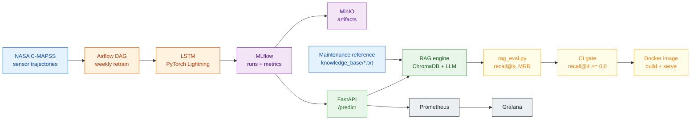
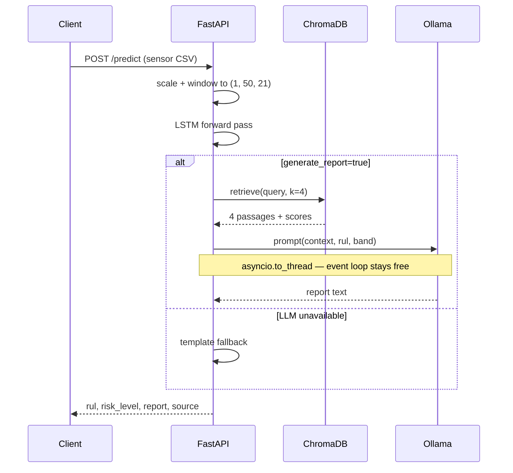

# AeroPredict: GenAI-Powered Predictive Maintenance Platform


**AeroPredict** is a production-shaped MLOps platform designed to predict the Remaining Useful Life (RUL) of aircraft turbofan engines. It integrates a PyTorch LSTM network for time-series forecasting with a GenAI diagnostics module (a local LLM via Ollama, model configurable) that generates maintenance recommendations.

The system is built on the NASA C-MAPSS dataset and orchestrates the entire lifecycle—from data ingestion to technician reporting—using Apache Airflow, MLflow, and Docker.

---

**At a glance** — MAE **9.51** cycles on the full FD001 test set · 220 unit tests · 15 CI jobs · LSTM + ChromaDB RAG + local LLM

### What it does

- **Deep Learning Forecasting:** A custom LSTM (Long Short-Term Memory) network trained on multivariate C-MAPSS sensor trajectories to predict RUL using an asymmetric safety-first loss (MSE with a higher penalty for late/under-estimated predictions), with fallback baseline when model is unavailable.
- **GenAI Diagnostics (RAG):** A ChromaDB vector index over a turbofan maintenance reference, retrieved per prediction and passed to a local LLM (via Ollama) to generate maintenance recommendations. The API includes a deterministic template fallback when the LLM is unavailable.
- **Automated Pipelines:** Apache Airflow DAGs manage the end-to-end workflow: Ingestion → Preprocessing → Training → Evaluation → Deployment.
- **Technician Dashboard:** A Streamlit interface connected to a FastAPI backend allows engineers to upload sensor logs and view instant predictions and AI-generated repair advice.
- **Full Observability:** Prometheus and Grafana monitor system health, container metrics, and inference latency in real-time.
- **Production Ready:** Kubernetes and Helm charts for scalable deployment on any cloud infrastructure.
- **CI/CD Pipeline:** GitHub Actions for automated testing, building, and deployment.

### Architecture

The system follows a microservices architecture orchestrated by Docker Compose and deployable to Kubernetes.


The LLM call is the slow part — roughly 50 seconds on CPU. It runs in a worker
thread so it cannot stall the event loop, which is what keeps `/` responsive
while a report is generating.



### Verified results

These numbers were reproduced from the code in this repository on a local
NVIDIA RTX 3050 Ti (4 GB). Follow [Quickstart](#quickstart) to reproduce them.

| Metric | Value | How it was measured |
|--------|-------|---------------------|
| Dataset | NASA C-MAPSS FD001 | 100 engines, 20,631 raw cycles |
| Training windows | 15,631 | 50-timestep windows built **per engine** |
| Features | 21 | C-MAPSS sensor channels (settings excluded) |
| Model | 2-layer LSTM (hidden 50) | 35,051 parameters |
| Loss | Asymmetric MSE (`late_penalty=5.0`) | Penalises late (under-estimated) RUL more |
| RUL target | `min(RUL, 125)` | Piecewise-linear cap (see below) |
| Best validation loss | ~280 | 60 epochs, early stopping |
| **Test MAE** | **9.51 cycles** | Full FD001 test set, 8,162 windows |
| **Test RMSE** | **13.58 cycles** | Full FD001 test set |
| Test MAPE | 12.43% | Full FD001 test set |

These are in line with published C-MAPSS FD001 results (single-model MAE is
typically 10–16 cycles). Evaluate them yourself:

```bash
python -c "
import sys; sys.path.insert(0, 'src')
from evaluate_model import evaluate_model
evaluate_model(
    test_data_path='CMAPSSData/test_FD001.txt',
    rul_file='CMAPSSData/RUL_FD001.txt',
)
"
```
The model originally predicted a near-constant RUL. Three independent defects
compounded; all three are now fixed and covered by regression tests.

**1. Uncapped training target caused mean-collapse.** 39% of FD001 samples have
RUL > 125, and those early cycles are indistinguishable from one another. Under
MSE the optimal prediction for that mass is the mean, so the network learned to
ignore its input. Verified on the old checkpoint: it returned `118.155` for
every input, and outputs varied by only **3.8 cycles** across 5×-scaled inputs.
The target is now capped at 125 (the standard C-MAPSS treatment, configurable
via `rul_cap`). Output spread after the fix is **101.9 cycles**.

**2. The test target was fabricated.** A test engine's trajectory is truncated
before failure, so `max_cycle - cycle` is *not* its RUL — it always yields 0 at
the final observed cycle, while the true value averages 75.5 cycles. Evaluation
now requires the matching `RUL_FDxxx.txt` and anchors the target there.

**3. Serving z-scored the upload while training MinMax-scaled it.** The API fed
the model out-of-distribution inputs. Training now persists the fitted scaler
(`models/scaler.joblib`) and serving reuses it via a shared
`preprocess_for_inference()` helper.

Fixing all three took test MAE from **53.70 → 9.51 cycles (5.6×)**.
The LSTM is a single model with no ensembling or uncertainty quantification.
Published state-of-the-art FD001 results reach MAE ≈ 8–10 cycles using
ensembles or attention architectures, so there is still headroom. The next
tracked step is replacing the LSTM with a temporal-convolution or small
Transformer encoder. This is documented rather than hidden so the metrics above
are not overstated.

### RAG, measured

The maintenance report is retrieved from a ChromaDB index over a turbofan
reference and written by a local LLM. Retrieval quality is scored against a
labelled question set rather than assumed:

| Metric | Value |
|---|---|
| `recall@4` | **1.000** (10 cases) |
| MRR | 0.900 |
| `hit@1` | 0.800 |

CI gates on `recall@4 >= 0.8`. The full methodology, the two findings it
produced, and the harness itself are in
[docs/OPERATIONS.md § Measuring retrieval quality](./docs/OPERATIONS.md).


### Quickstart

```bash
uv sync --extra dev                 # uv.lock is the install source
uv run python -m src.train_model    # train the LSTM
uv run uvicorn src.api:app --port 8000
curl -X POST http://localhost:8000/predict \
     -H "X-API-Key: demo-secret-key" \
     -F "file=@engine_FD001.txt"     # last 50 cycles of one engine
```

Setup detail, dataset download, configuration and troubleshooting:
**[docs/OPERATIONS.md](./docs/OPERATIONS.md)**.

### Stack

| Service | Port | | Service | Port |
|---|---|---|---|---|
| FastAPI | 8000 | | Prometheus | 9090 |
| Streamlit UI | 8501 | | Grafana | 3001 |
| MLflow | 5001 | | Airflow | 8081 |
| MinIO | 9000 | | TLS proxy | 8443 |


Run this project alone with `./run_stack.sh` (API, MLflow, MinIO, Prometheus, Grafana). Dashboard: `streamlit run src/app.py` (port 8501). Airflow and the Postgres feature store run through `docker compose`. The four-project orchestrator used during development is kept in the author's workspace and is not part of this repository.

### API

All endpoints except `/` and `/metrics` require `X-API-Key`. Full payloads and
error codes: [docs/OPERATIONS.md](./docs/OPERATIONS.md).

| Method | Path | Limit | Purpose |
|--------|------|-------|---------|
| `GET` | `/` | none | Health: `model_loaded`, `rag_available`, `auth_enabled` |
| `POST` | `/predict` | 60/min | Sensor CSV in, RUL + risk band out |
| `GET` | `/reports/{id}` | 120/min | Poll a report started with `?async_report=true` |
| `GET` | `/drift` | 30/min | Population Stability Index vs training baseline |
| `POST` | `/admin/reload-model` | 5/min | Reload the checkpoint without a restart |
| `GET` | `/metrics` | none | Prometheus exposition |

### Security

| Control | Implementation |
|---|---|
| Auth | `X-API-Key` via `secrets.compare_digest` (constant-time) |
| TLS | nginx reverse proxy, TLSv1.2/1.3, `server_tokens off` |
| Upload limits | `Content-Length` rejected before the body is read |
| Rate limits | Per-endpoint, configurable, 429 on breach |

**Not in place:** RBAC, a secret manager, multi-node HA, a soak test. The
systems are *production-shaped*, not production-grade.

### Tests and CI

| | |
|---|---|
| Unit tests | **220** (8 integration tests run against the live stack) |
| CI jobs | **12**: 3.10 + 3.11 matrix, ruff, mypy, Bandit, pip-audit, Trivy SARIF, Terraform validate, Docker build-and-serve, RAG eval, README-count check |

## Roadmap

1. **Measure the generated report, not only retrieval.** Retrieval is scored
   (`recall@4 = 1.000`); the LLM's prose is not. Add a grounding check that
   every number in a report appears in the retrieved context, then an
   LLM-as-judge faithfulness score once a judge model runs in CI.
2. **Serve from the lock file.** `Dockerfile.serve` still installs
   `requirements-serve.txt`, a second source of truth beside `uv.lock`. Generate
   it from the lock so the image and the tested environment cannot diverge.
3. **Run the retraining DAG end to end.** The Airflow DAG is written and its
   tasks are unit-tested, but no scheduled run has been executed in this
   workspace. Trigger one and link the MLflow run it produces.
4. **Beat the LSTM.** Replace it with a temporal-convolution or small
   Transformer encoder, the next step the model's own limitations section names,
   and keep the same test split and harness so the comparison is like-for-like.

---

**Author** — Khaled Saifullah · [GitHub](https://github.com/ksnishat)
